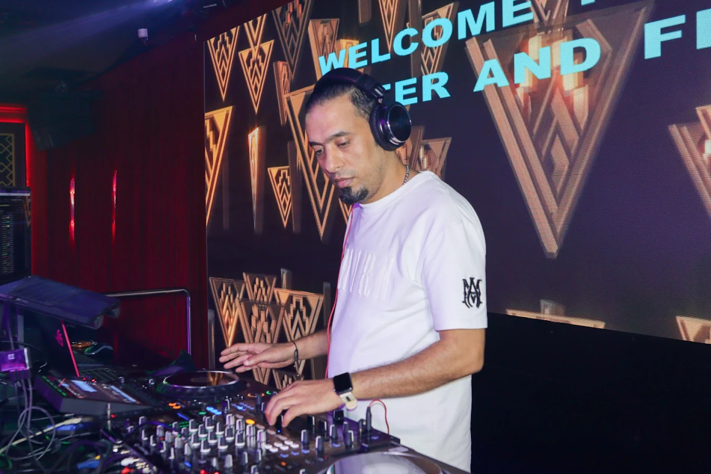

# 🍾 Upyard Rooftop Lounge 
### Designed & Developed by CKR STUDIOS

---

## 📁 FOLDER STRUCTURE

```
Upyard-Website/
│
├── index.html              ← Main HTML file (all content lives here)
│
├── css/
│   └── style.css           ← All styling, colors, fonts, layout, responsive
│
├── js/
│   └── main.js             ← All interactivity (cursor, tabs, modal, gallery)
│
└── assets/
    ├── video/
    │   ├── hero-bg.mp4     ← ⭐ REPLACE with your 4K nightclub video
    │   └── hero-bg.webm    ← Optional WebM version for better browser support
    │
    └── images/
        ├── hero-poster.jpg     ← Fallback image if video doesn't load
        ├── about-main.jpg      ← About section main photo
        ├── gallery-1.jpg       ← Gallery image 1 (large, landscape)
        ├── gallery-2.jpg       ← Gallery image 2
        ├── gallery-3.jpg       ← Gallery image 3
        ├── gallery-4.jpg       ← Gallery image 4
        ├── gallery-5.jpg       ← Gallery image 5
        ├── gallery-6.jpg       ← Gallery image 6
        ├── gallery-7.jpg       ← Gallery image 7
        ├── exp-nightlife.jpg   ← Experience tab: Nightlife
        ├── exp-bar.jpg         ← Experience tab: Bar
        ├── exp-shows.jpg       ← Experience tab: Live Shows
        └── exp-vip.jpg         ← Experience tab: VIP
```

---

## 🎬 HOW TO ADD YOUR VIDEO

1. Export your nightclub video as `.mp4` (H.264) and optionally `.webm`
2. Place the files in `assets/video/`
3. Name them: `hero-bg.mp4` and `hero-bg.webm`
4. The video will automatically play muted, looped, and fullscreen in the hero
5. Recommended: 10–30 seconds, dark atmosphere, 1080p or 4K

**If you want to use a different filename**, edit `index.html` around line 120:
```html
<source src="assets/video/YOUR-FILENAME.mp4" type="video/mp4">
```

---

## 🖼️ HOW TO ADD IMAGES

Copy your venue photos into `assets/images/` with the filenames listed above.

**To use your own filenames**, find and replace in `index.html`:
```html

<!-- Change to: -->

```

---

## ✏️ COMMON EDITS

### Change Phone Number
Search and replace `971501373678` in `index.html` with your number.
Also update the display text `+971 50 137 3678`.

### Change Colors
Open `css/style.css` — all colors are at the top in `:root {}`:
```css
:root {
  --deep-red: #B0001F;     ← Main red color
  --gold:     #C9A84C;     ← Gold accent color
  --black:    #080608;     ← Background
}
```

### Change Offers Bar Text
In `index.html`, find `id="offers-bar"` and edit the `offer-pill` divs.

### Change Menu Prices
Search for `AED` in `index.html` to find all prices.

### Change Opening Hours
Find the `hours-tbl` table in `index.html` around the INFO section.

### Add/Remove Gallery Images
Find `class="gallery-grid"` in `index.html` and add/remove `<div class="g-item">` blocks.

### Change Google Maps Link
Search for `maps.google.com/?q=Tonic` and replace with your actual embed URL.

---

## 🌐 TO GO LIVE (DEPLOY)

1. Upload the entire `TONIC-Website/` folder to your hosting (cPanel, Hostinger, etc.)
2. Make sure `index.html` is in the root folder
3. For a custom domain, point your DNS to your hosting IP
4. For SSL (https://), enable it in your hosting control panel (usually free with Let's Encrypt)

**Recommended hosting**: Hostinger, SiteGround, or Namecheap Hosting (~$3–5/month)

---

## 📊 SEO ALREADY INCLUDED

The website includes:
- ✅ Meta title, description, keywords
- ✅ Open Graph tags (for social sharing)
- ✅ Twitter Card tags
- ✅ Structured Data (JSON-LD for Google Business)
- ✅ Semantic HTML (headings, nav, section, aria labels)
- ✅ Mobile responsive
- ✅ Fast loading (lazy images, minimal dependencies)

To improve SEO further:
1. Add your actual business URL to `og:url` in `index.html`
2. Add a real preview image to `og:image`
3. Create a `sitemap.xml` file
4. Submit to Google Search Console

---

## 📞 SUPPORT

Built by **CKR STUDIOS**
For edits, improvements or new features — contact CKR STUDIOS.
